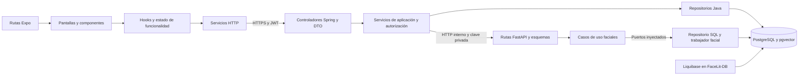

# Arquitectura de FaceLit — HU-48

Corte: 2 de noviembre de 2026. Estado de los árboles locales, pendiente de publicación y aceptación operativa. Este documento describe los límites vigentes; el corte del 27 de octubre se conserva como antecedente.

## Componentes y dependencias

Spring es un monolito modular. FastAPI es un servicio especializado. PostgreSQL sigue físicamente compartido; los roles y permisos limitan la cuenta facial. Este diseño no presupone DDD completo ni independencia física por servicio.

## Organización por repositorio

| Repositorio | Organización | Regla de dependencia |
|---|---|---|
| FaceLit | app para rutas y layouts; features para pantallas/componentes/hooks; shared para infraestructura común | Los componentes usan hooks/servicios; un hook de asistencia no importa el hook de enrolamiento para obtener constantes o tipos |
| FaceLit-Backend | Controladores y DTO; servicios de aplicación; repositorios y clientes de integración | Un controlador traduce HTTP y delega; el servicio resuelve identidad, reglas y alcance. El enrolamiento activo no mantiene una transacción SQL abierta durante inferencia remota |
| micro-facial | API y esquemas; servicios/reglas; domain para valores; repositorios y workers como adaptadores | api/dependencies.py construye los adaptadores. El servicio recibe repositorio, generador y unidad de trabajo mediante contratos; no los crea internamente |
| FaceLit-DB | DDL/DML/DCL, migraciones, reversas y scripts de operación/prueba | Evolución mediante changesets; contract explícito; permisos comprobados con SQL y en integración temporal |

Login y notificaciones conservan sus rutas Expo. Sus entradas delegan a pantallas en features. La animación de recuperación y el detalle de notificaciones tienen componentes propios; los estilos están separados. Los estados de captura se mantienen en sus hooks para conservar temporización, cancelación y aislamiento. Los tipos y umbral de brillo compartidos están en features/facial/captureTypes.ts y captureQuality.ts; useFacialRegistration mantiene sus exportaciones existentes por compatibilidad.

## Autoridad y datos compartidos

| Objeto o decisión | Responsable | Consumidores y permisos |
|---|---|---|
| Identidad, roles, fichas y sesiones | Spring | Resuelve principal, aprendiz y candidatos autorizados; FastAPI no consulta estos dominios |
| facialrecognition.user_face | FastAPI para plantilla | SELECT/INSERT/UPDATE de la cuenta facial. Spring lee metadatos de existencia/fecha y conteos; no escribe el vector |
| facialrecognition.face_reset_request | Spring para aprobación y ciclo de solicitud | FastAPI lee columnas de autorización y solo actualiza consumo/auditoría; no puede aprobar solicitudes |
| facialrecognition.facial_event | Spring | El rol facial no recibe permisos sobre eventos de asistencia |
| Esquema y grants | FaceLit-DB | Liquibase aplica antes de validar/arrancar las aplicaciones; cuenta migradora distinta de runtime |

La base compartida incluye relaciones entre dominios. Las consultas de metadatos de Spring son consumidores expresos del contrato de datos. Una futura separación física exige reemplazarlas por contratos o proyecciones, con transición compatible.

## Contratos que conserva la refactorización

- El cliente continúa con /api/facial/embeddings/from-image y /liveness-check; los campos, restricciones, respuestas y nombres OpenAPI Registration/Liveness se conservan.
- Spring deriva apprentice_id, reset_owner_user_id y created_by desde la sesión validada. La clave interna y los vectores no se envían al navegador.
- Asistencia conserva la validación de sesión/ficha y recibe la comparación de candidatos autorizados. FastAPI no resuelve sesiones desde SQL.
- /api/facial/me, /registration-status y /registration-confirmation mantienen sus respuestas. padAvailable es metadato legado de configuración; no habilita un proveedor alternativo.
- /api/facial/challenge, /enrollment y /profile-photo siguen denegadas en seguridad. Se retiraron su implementación incompatible, el adaptador PAD antiguo y las pruebas de ese código inalcanzable. Las pruebas HTTP comprueban la denegación para los tres roles.
- Las URLs de backend, FastAPI y PostgreSQL, nombres de servicios y permisos del flujo activo conservan su contrato. El runner integrado usa un login facial restringido y recursos temporales exclusivos.
- Los cambios de estado y permisos del catálogo de ambientes permanecen separados de la preparación de sesiones del instructor.

## Verificación de la arquitectura

| Verificación | Alcance |
|---|---|
| Maven test | Contratos HTTP, permisos, servicios, persistencia de pruebas y OpenAPI |
| Jest y scripts frontend | Captura, sesión, navegación, formularios, decisiones de notificaciones y estados de interfaz |
| TypeScript, lint y export web | Tipos, dependencias/importaciones y compilación de rutas Expo |
| Pytest | Reglas faciales, inferencia aislada, persistencia, errores y seguridad HTTP |
| test-nomenclature-migration.ps1 | Datos legados, expand por defecto, contract explícito, reversas y contrato de privilegios |
| test-architecture-e2e.ps1 | JWT, enrolamiento y asistencia a través de Spring/FastAPI/PostgreSQL; inferencia determinista |
| Pruebas de scripts DB | Restauración del entorno y propagación de fallos de comandos |

La cantidad de pruebas Java cambia al retirar las pruebas del enrolamiento abandonado. Las comprobaciones de seguridad y los endpoints activos siguen cubiertos; el conteo no se usa como calificación de arquitectura.

## Aceptación pendiente

Las pruebas sintéticas no miden exactitud biométrica ni sustituyen cámara física. Faltan aceptación con dispositivos reales, despliegue/rollback sobre el servidor, política institucional de retención y revisión independiente sobre los commits finales. No se recalculan las puntuaciones originales sin su método de evaluación.

La evidencia y el estado de ejecución se registran en [Evaluación HU-48](Evaluacion_Arquitectura_y_Brechas_HU48.md).
