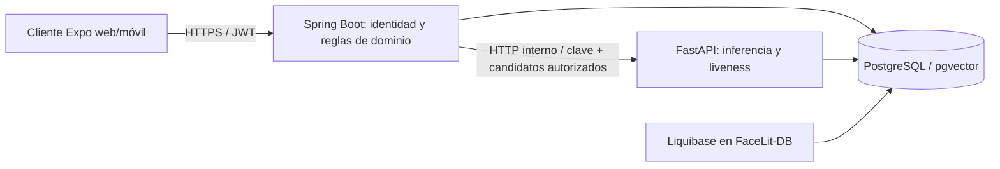

# FaceLit — evaluación arquitectónica y brechas de la HU-48

**Línea base:** Evaluación E2E con corte del 30 de octubre de 2026.  
**Revisión complementaria:** ramas locales `hu-48` al 2 de noviembre de 2026.  
**Propósito:** conservar las estadísticas de la evaluación, verificar qué cambió en las ramas de trabajo y dejar una ruta de mejora arquitectónica que respete los flujos existentes.

> La puntuación que sigue pertenece al corte original de la evaluación. No es una recalificación de `hu-48`. Los hallazgos de código distinguen entre lo observado en el corte y lo comprobado en las ramas actuales.

## 1. Resumen de evaluación

| Indicador | Resultado al corte |
|---|---:|
| Puntaje global | 65/100 (64,6 sin redondear) |
| Juicio | D; el umbral siguiente es 70 |
| Flujos E2E completos | 4 de 5 |
| Bloqueantes / críticos | 0 / 0 |
| Altos / medios / bajos | 7 / 15 / 7 |
| Flujo incompleto | Gestión de ambientes del coordinador |

### Puntaje por dimensión

| Dimensión | Nombre | Puntaje | Repositorio con menor puntuación |
|---|---|---:|---|
| D1 | Entrega y estructura | 88 | FaceLit-Backend · 69 |
| D2 | Reproducibilidad | 75 | FaceLit-Backend · 45 |
| D3 | Arquitectura y congruencia | 58 | micro-facial · 50 |
| D4 | Calidad de código | 67 | FaceLit · 54 |
| D5 | Seguridad | 87 | FaceLit-DB · 50 |
| D6 | Pruebas | 78 | FaceLit-DB · 55 |
| D7 | DevOps y despliegue | 49 | FaceLit-Backend · 56 |
| D8 | Datos | 75 | FaceLit-DB · 75 |
| D9 | API y contratos | 55 | FaceLit-Backend · 30 |
| D10 | Frontend y móvil | 50 | FaceLit · 50 |
| D11 | IoT y firmware | — | — |
| D12 | Documentación y trazabilidad | 44 | FaceLit-DB · 0 |
| D13 | Proceso y colaboración | 68 | Sin dato por repositorio |
| D14 | Extremo a extremo | 50 | Sin dato por repositorio |

**Nota de consistencia:** D7 muestra un puntaje dimensional de 49 y un menor resultado de repositorio de 56. Se conserva el dato tal como aparece en la fuente; la diferencia requiere revisar la hoja de cálculo o fórmula original antes de recalcular.

## 2. Estado de la revisión en `hu-48`

| Repositorio | Rama y revisión local | Cambios de arquitectura comprobados en el árbol actual |
|---|---|---|
| FaceLit | `hu-48-dev` · `b2ec3c0` + cambios locales de HU-48 | La preparación de sesiones conserva búsqueda/creación de ambientes para instructor. Se implementó una pantalla de coordinación para listar, crear, editar y activar/desactivar ambientes; la desactivación conserva historial. Se retiraron del README variables faciales públicas que el código no usa; el JWT web vive en memoria (la recarga exige login) y móvil conserva SecureStore. |
| FaceLit-Backend | `hu-48-dev` · `1d7f968` + cambios locales de HU-48 | Hay contrato Springdoc en `/v3/api-docs` y endpoint `/health`. `/api/environment/**` permanece limitado a `INSTRUCTOR`; el nuevo `/api/admin/environments/**` separa el catálogo y requiere `COORDINATOR`. Bloquea desactivación con sesiones futuras/activas y evita renombrar ambientes con sesiones históricas. |
| micro-facial | `hu-48-dev` · `5e44ce8` + cambios locales de HU-48 | Imagen multi-etapa, usuario no root, `HEALTHCHECK`, OpenAPI desactivado fuera de `local`, CORS explícito y `allow_credentials=false`. Spring resuelve el aprendiz autenticado; micro-facial recibe `apprentice_id`, dueño de reset y candidatos autorizados. El código consulta solo `facialrecognition`; CI prepara un login restringido y comprueba permisos positivos/negativos. |
| FaceLit-DB | `hu-48-main` · `89b8d72` + cambios locales de HU-48 | Liquibase incorpora rol/grants faciales y reversas; script provisiona login sin guardar contraseña. CI de micro-facial crea el rol en PostgreSQL desechable. Migraciones verificadas en PostgreSQL temporal; workflows remotos pendientes para estos cambios. |

Los cuatro working trees de código estaban limpios al iniciar esta revisión. `facelit-docs` ya tenía cambios locales y anexos nuevos; se conservaron intactos. Esta evaluación complementaria se agrega como documento independiente.

## 3. Arquitectura observada

El backend es un monolito modular y la API de inferencia es un servicio independiente. Ambos usan el mismo PostgreSQL físico. El rol dedicado limita el acceso de micro-facial a objetos faciales, pero no crea aislamiento físico de base ni reemplaza la validación E2E del despliegue.

### Flujo facial que debe mantenerse

1. El cliente captura y envía la solicitud a Spring; no recibe la clave interna ni llama directamente a FastAPI.
2. Spring valida identidad, rol, ficha/sesión y reglas de negocio.
3. Spring obtiene los aprendices activos asociados a la ficha de la sesión e invoca FastAPI por red privada, enviando esa lista acotada.
4. FastAPI compara solo contra esos IDs y devuelve el resultado mínimo; ya no resuelve la ficha ni la sesión desde la base compartida.
5. Spring aplica las reglas de asistencia y registra el resultado de dominio.
6. El cliente recibe una respuesta sin embedding ni credenciales internas.

La respuesta síncrona actual mantiene la operación fácil de seguir. Cualquier cambio a colas, eventos o procesamiento diferido requiere idempotencia, correlación, estados visibles y una decisión operativa antes de modificar el flujo.

## 4. Brechas arquitectónicas verificadas y decisiones

### A1. Separación de datos de micro-facial — prioridad alta; separación lógica y grants implementados, gate de integración pendiente

`micro-facial/app/repositories/facial_embedding_repository.py` opera sobre `facialrecognition.user_face` y `facialrecognition.face_reset_request`. El cambio local HU-48 elimina sus lecturas directas a `security`, `academic` y `environment`: Spring resuelve el aprendiz autenticado, valida la sesión y envía `apprentice_id`, dueño del token de reset y candidatos autorizados. La búsqueda facial se limita a esa lista y a plantillas activas. La configuración sigue usando la cuenta compartida de PostgreSQL; sin grants mínimos, una vulnerabilidad aún podría leer otros esquemas.

**Dirección aplicada:** Spring es dueño de identidad, alcance académico y sesiones; FastAPI es dueño de inferencia y persistencia facial. El contrato interno ya envía IDs resueltos y autorizados. FaceLit-DB define el grupo `facelit_micro_facial` y grants a `facialrecognition`; el script de provisionamiento crea el login de runtime sin incluir secretos en el repositorio. La CI configura el login y comprueba que pueda acceder a `user_face` y no a `academic.apprentice`.

**Criterio de cierre parcial:** consultas y permisos están acotados; la CI incorpora probe de privilegios. Falta ejecutar CI y validar enrolamiento, reset, liveness y asistencia con el rol dedicado en la integración completa. La base física sigue compartida.

### A2. La gestión de ambientes tiene dos responsabilidades confundidas — prioridad alta

La API `/api/environment/environments` forma parte de la preparación de sesiones del instructor y se mantiene restringida a `INSTRUCTOR`. La coordinación ahora dispone de `/api/admin/environments/**`, protegido por la regla existente para `COORDINATOR`, y de pantallas de listado/creación/edición. Editar y activar/desactivar están implementados. La desactivación conserva historial y rechaza sesiones activas/futuras; el renombrado se rechaza si existen sesiones históricas. No se ofrece borrado físico ni asignación explícita de fichas: `environment.chip_environment` no interviene en el flujo actual, así que esa semántica debe acordarse antes de implementarla.

**Dirección aplicada:** preservar los endpoints de sesión para instructor y separar el catálogo en `/api/admin/environments/**`, con permiso `COORDINATOR`, DTO explícitos y cambios auditados. La API impide desactivar mientras haya sesiones activas/programadas y conserva el nombre cuando hay sesiones históricas. La asignación de ficha requiere una decisión funcional porque el flujo de sesión ya relaciona ambiente y ficha por sesión y no consume `chip_environment`.

**Criterio de cierre parcial:** API y UI de catálogo ya están conectadas. Falta validar con pruebas de integración/roles, acordar asignación de ficha y confirmar si “eliminar” significa desactivar. El flujo E2E no se marca completo hasta ejecutar y aprobar esas verificaciones.

### A3. Los límites de datos no están expresados como contrato versionado — prioridad alta

Spring y FastAPI comparten el PostgreSQL físico; micro-facial opera sobre objetos `facialrecognition` y conserva claves foráneas hacia identidad/aprendiz. Liquibase versiona la base, pero no valida por sí solo compatibilidad de DDL ni aplica grants mínimos al usuario del servicio.

**Dirección aplicada y pendiente:** se documentaron dueño y consumidores de los objetos faciales, se limitó el rol de micro-facial y se añadió una comprobación de permisos al workflow. Sigue pendiente validar compatibilidad de DDL entre versiones y definir contratos para cambios expandidos/contractivos antes de retirar columnas o relaciones. OpenAPI no cubre las consultas SQL compartidas.

**Criterio de cierre:** cada objeto compartido tiene dueño y consumidores documentados; CI detecta la ausencia de grants/vistas o un cambio incompatible antes de desplegar.

### A4. El catálogo de API mejora, falta una estrategia común de compatibilidad — prioridad media

Springdoc está incluido en la rama de backend y FastAPI ya expone OpenAPI en local. El cliente todavía mantiene tipos y rutas de manera manual, y Spring conserva rutas históricas bajo `/api/...` sin una versión común. Cambiar respuestas de forma independiente puede volver a introducir divergencias entre web, Spring y FastAPI.

**Dirección propuesta:** versionar contratos como artefactos revisables; establecer reglas de compatibilidad y ejemplos de payload; añadir una comparación de contrato cliente-servidor en CI. Un prefijo `/api/v1` se debe introducir con ruta de transición y actualización coordinada del cliente, no mediante un cambio masivo de URLs.

### A5. Configuración de captura tiene valores distintos — prioridad media

La evaluación original detectó diferencia entre frames del cliente (1) y el rango de micro-facial (3–18). El micro actual valida `liveness_min_frames` entre 2 y 8 y `liveness_max_frames` entre 2 y 24, con defaults 3 y 15. Este corte no volvió a inspeccionar los productores de payload del cliente ni el contrato de asistencia completo; por eso la discrepancia requiere comparación explícita antes de declarar cierre.

**Dirección propuesta:** definir límites en el contrato de solicitud y exponer capacidades compatibles; validar en el cliente para UX y volver a validar en FastAPI como autoridad técnica. No copiar defaults en varias capas sin una prueba de contrato.

### A6. Seguridad del cliente y datos biométricos sigue teniendo trabajo — prioridad alta

Se retiraron del README de FaceLit las variables `EXPO_PUBLIC_EMBEDDING_*` que no consume el código; `tokenStorage.js` conserva el JWT web en memoria y limpia la entrada legada de localStorage. La guía de arquitectura indica que el cliente no debe conocer la clave facial. La política de autorización, retención y borrado debe abarcar tanto metadatos como embeddings y registros de reset.

**Dirección aplicada y pendiente:** el JWT web se mantiene en memoria y la entrada persistida legada se elimina; una recarga requiere login. La API sigue usando Bearer y no introduce cookies. La prevención de XSS sigue siendo necesaria. Falta la política institucional biométrica antes de programar purgas o plazos.

## 5. Brechas por puntaje bajo: repositorio y trabajo relacionado

| Dimensión | Menor resultado | Brecha prioritaria de la evaluación | Trabajo en `hu-48` / decisión pendiente |
|---|---|---|---|
| D3 · Arquitectura | micro-facial · 50 | Base compartida y permisos más amplios que su dominio | A1: consultas y grants limitados implementados; validar flujos con rol restringido. A3: compatibilidad de esquema/contratos sigue pendiente |
| D4 · Calidad | FaceLit · 54 | Pantallas extensas, baja cobertura de accesibilidad y manejo irregular de errores | Refactor por funcionalidad sin alterar rutas; primero inventario y criterios de aceptación |
| D5 · Seguridad | FaceLit-DB · 50 | Semilla de coordinador, permisos DB y consistencia de nomenclatura | Revisar seed vigente y grants antes de definir migración; no trasladar credenciales al cliente |
| D6 · Pruebas | FaceLit-DB · 55 | Pruebas de migración omitidas en CI | Ejecutar escenarios Liquibase en un PostgreSQL efímero y validar rollback/reaplicación |
| D7 · DevOps | FaceLit-Backend · 56 en el desglose | Ausencia de despliegue repetible y rollback de aplicación | La guía de Hostinger tiene cambios locales en `facelit-docs`; mantenerlos y reconciliarlos antes de documentar procedimiento final |
| D8 · Datos | FaceLit-DB · 75 | Índices, expand/contract y CHECK de idioma según evaluación | Changesets nuevos para índices de sesión/credencial/token y PT; contract exige contexto explícito; ambos escenarios de migración/rollback/reaplicación pasaron localmente |
| D9 · API | FaceLit-Backend · 30 | Falta de contrato y estrategia de versión según corte original | Springdoc ya existe en `hu-48`; falta comprobar CI de compatibilidad y plan de versionado |
| D10 · Frontend | FaceLit · 50 | Arquitectura de pantallas, accesibilidad y sesión web | Retirar configuración facial pública y definir estrategia segura de token antes de reorganizar auth |
| D12 · Trazabilidad | FaceLit-DB · 0 | Referencias de scripts y documentación duplicadas/ausentes | Esta evaluación y el mapa de arquitectura ya están enlazados; consolidar guías E2E/despliegue tras reconciliar anexos locales y enlazar cada requisito a evidencia final |

## 6. Secuencia de implementación recomendada

1. **Congelar contrato y mapa de datos:** listar para cada flujo quién autentica, valida dominio, lee y escribe; anotar payload, tablas y permisos actuales.
2. **Cerrar compatibilidad sin cambios de infraestructura:** comparar frames/payloads de asistencia, documentar contratos OpenAPI y validar que cambios de API no rompan al cliente.
3. **Aplicar la frontera de datos en integración:** el servicio ya recibe IDs resueltos para enrolamiento/reset/asistencia y el rol mínimo está definido; ejecutar CI y el flujo completo con la credencial restringida.
4. **Cerrar catálogo de ambientes:** API y UI de coordinación están implementadas; validar roles, historial, capacidad y estados, y acordar si se requiere asignación de ficha o borrado lógico.
5. **Cerrar calidad y seguridad del cliente:** reducir pantallas extensas, cubrir estados de error/accesibilidad y elegir almacenamiento web para la sesión antes de reestructurar autenticación.
6. **Cerrar trazabilidad y despliegue:** CI para migraciones, guía de despliegue/rollback reconciliada con los cambios locales y evidencia por flujo ligada a commits concretos.

### Gate de integración por flujo

| Flujo | Propietario de autorización/reglas | Sistema que persiste | Evidencia necesaria antes de desplegar |
|---|---|---|---|
| Login y recuperación | Spring | PostgreSQL, vía Spring | contrato HTTP, autorización y sesión revocable |
| Enrolamiento facial | Spring autoriza; FastAPI infiere | Facade facial según contrato aprobado | prueba con DB real, autorización de enrolamiento y reset |
| Asistencia facial | Spring valida sesión/ficha; FastAPI evalúa rostro | Spring para evento; componente facial para plantilla | prueba E2E con permisos de sesión y deduplicación |
| Carga CSV | Spring | PostgreSQL, vía Spring | validación por fila, transacción y reporte consistente |
| Gestión administrativa de ambientes | Coordinación vía API `/api/admin/environments/**`; catálogo separado de la sesión del instructor | Spring y PostgreSQL | verificar permisos, ciclo de vida, historial, capacidad y UI mediante integración |

## 7. Fuentes y límites de esta revisión

- Evaluación: `FaceLit_Evaluacion_E2E_2026-10-30 (1).md` y captura de “Puntaje por dimensión”.
- Diseño vigente: `03_Analisis_Software/Arquitectura_Implementada_2026-10-27.md`, `05_Diseno_Software/05_Diseno_Software.md` y `05_Diseno_Software/Flujos_Funcionales.md`.
- Evidencia de ramas locales al corte: FaceLit `b2ec3c0`, FaceLit-Backend `1d7f968`, micro-facial `5e44ce8`, FaceLit-DB `89b8d72`.
- La revisión inicial fue estática; el apartado 8 registra las verificaciones ejecutadas después. No se recalcularon puntuaciones ni se acredita aceptación en producción.

## 8. Correcciones y evidencia local del 2 de noviembre

| Dimensiones | Corrección concreta | Evidencia y condición restante |
|---|---|---|
| D1 / D2 | Backend incorpora `.env.example` con valores de ejemplo y secretos externalizados | Spring lee variables del proceso, no carga `.env` automáticamente; la cuenta de cada entorno debe existir |
| D3 / D5 | Spring resuelve identidad/candidatos; micro-facial opera solo en objetos faciales con grants limitados | Frontera de datos y rol versionados; despliegue debe configurar la credencial restringida |
| D4 / D10 | Persistencia de preferencias centralizada con manejo de fallos; JWT web en memoria y limpieza del token legado | Scripts de sesión pasaron; 131 pruebas Jest existentes y una nueva prueba de no persistencia pasaron. Recargar web exige autenticación |
| D6 / D8 | Índices de security, idioma PT, contract con contexto explícito y escenarios de migración en CI | `test-nomenclature-migration.ps1`: PASS con datos legados, expand por defecto, contract explícito, ambos rollbacks y reaplicación. `test-hu002-migration.ps1`: PASS actualización/rollback/reaplicación |
| D9 | Contrato OpenAPI existente verificado y contratos faciales alineados | Pruebas Springdoc y HTTP incluidas en las 183 pruebas Java aprobadas |
| D14 | Catálogo del coordinador separado de sesiones del instructor; cambios persisten y no reactivan ambientes deshabilitados | Pruebas de integración cubren rol, edición, desactivación persistente y conflicto con sesión activa |
| D12 | Tabla original, límites de dominio, cambios y evidencia reunidos en este documento | La línea base 65/100 permanece histórica; no se asignan cifras sin la rúbrica de evaluación |

**Resultado local:** backend Maven: 183 pruebas, cero fallos/errores. Micro-facial en contenedor Linux: 148 aprobadas y una prueba PostgreSQL opcional omitida en esa ejecución. Frontend: tipos sin errores; lint sin errores y 29 advertencias existentes. La cobertura Jest reportada cubre la selección de archivos del proyecto, no toda la aplicación.

**Pendientes de aceptación externa:** despliegue y rollback demostrados sobre Hostinger (D7), política institucional de retención/supresión biométrica (parte de D5), revisión independiente/protecciones de PR (D13), publicación coordinada y CI verde sobre commits finales. No se borran ramas ni se rotan credenciales de un entorno instalado como parte de pruebas locales.

**Integración cruzada ejecutada:** `test-architecture-e2e.ps1 -SkipImageBuild -MicroImage facelit-micro:current-dev-local` pasó con los árboles locales y PostgreSQL temporal; `ArchitectureFlowPostgresIT`: una prueba, cero fallos/errores. Evidencia local en `FaceLit-DB/.tmp/facelit-arch-e2e-ccd0d777/`. La inferencia es determinista: no certifica cámara física ni exactitud de reconocimiento. El catálogo administrativo tiene dos pruebas de integración en la suite Java.

**Release preparado:** backend y micro-facial incorporan `container-release.yml`, manual, que exige CI exitosa antes de publicar una imagen GHCR con revisión/número de ejecución y artefacto de digest. Los YAML se analizaron sin errores. El Compose de `deploy/` acepta referencias de imagen para actualización/reversión y exige una URL facial con login exclusivo; su configuración se validó con datos ficticios, sin arrancar producción. Los workflows no se han publicado ni ejecutado remotamente.

## 9. Contraste de arquitectura documental con HU-48

Revisión estática de Arquitectura_Implementada_2026-10-27.md, Diseño de Software, Flujos_Funcionales.md, Patrones_Diseno_Verificados.md y secciones de arquitectura del SRS. Estos documentos contienen responsabilidades, restricciones y decisiones; no contienen una ponderación que permita reproducir la nota D3.

| Aspecto | Documento y código actual | Resultado |
|---|---|---|
| Clasificación | Cliente-servidor; Spring es un monolito modular; FastAPI es servicio especializado | Congruente. El repositorio de DB administra migraciones y no es un cuarto microservicio |
| Flujo facial | Cliente llama a Spring; Spring autoriza y envía candidatos/propietario resueltos a FastAPI | Congruente en el flujo activo; el cliente no recibe la clave interna |
| Persistencia | Ambos procesos usan PostgreSQL; FastAPI consulta solo objetos faciales | Separación lógica y grants definidos; no es persistencia físicamente independiente |
| Propiedad de tablas | Spring consulta user_face para estado/fecha de registro, existencia de plantilla y conteos académicos | Documentar consumidores de metadatos expresamente. La propiedad facial no implica consumidor exclusivo; un aislamiento mayor requeriría vistas o un contrato HTTP |
| Capas Java | FacialEmbeddingController resuelve el aprendiz mediante repositorio, valida elegibilidad y construye el payload interno | Resuelto en la refactorización posterior: reglas extraídas a FacialEmbeddingRegistrationService y DTO independientes; el controlador delega y conserva HTTP/OpenAPI |
| Código legado | FacialEnrollmentController contiene SQL de un esquema anterior | Implementación antigua y adaptador retirados tras revisar dependencias; SecurityConfig conserva la denegación y pruebas HTTP la comprueban para los tres roles |
| Concurrencia facial | El trabajador procesa frames secuencialmente; el servicio usa asyncio.to_thread y la ruta de liveness run_in_threadpool | Actualizar la explicación histórica: la inferencia sigue siendo síncrona dentro del trabajador, pero se deriva a un hilo para no ejecutarla directamente en el event loop. No implica reconocimiento paralelo ni una garantía de latencia |
| Catálogo de ambientes | HU-48 separa administración de coordinación y operación de sesión de instructor | Incorporado en el addendum; los documentos del 27 de octubre son referencia histórica |
| Referencias | Patrones enlazaba dos documentos con nombres inexistentes | Corregidos los enlaces a Diseño de Software y Flujos_Funcionales existentes |

No se atribuye al sistema DDD completo, arquitectura hexagonal o Clean Architecture estricta solo por sus carpetas, interfaces o patrones. La siguiente revisión debe verificar dependencias entre módulos, consumidores de tablas y contratos antes de proponer una separación adicional.

## 10. Refactorización arquitectónica y verificación final local

La referencia consolidada es [Arquitectura HU-48](Arquitectura_HU48.md). Se preservaron rutas, payloads, nombres OpenAPI, reglas de captura y respuestas de los endpoints activos.

- Backend: controlador de registro delega en servicio de aplicación; DTO separados. Se retiró el código de enrolamiento Java incompatible y su adaptador PAD. Los endpoints activos de estado/confirmación permanecen; las rutas retiradas siguen bloqueadas. Maven: 170 pruebas aprobadas. La cantidad baja al retirar las pruebas de la implementación abandonada; se sustituyeron por comprobaciones HTTP de permisos y respuestas vigentes.
- Frontend: rutas de login y notificaciones delegan en pantallas de funcionalidad; animación, detalle y estilos extraídos. Tipos y brillo de captura compartidos ya no dependen del hook de enrolamiento. Se eliminó ts-nocheck del login y se limpiaron importaciones, variables y dependencias de hooks. Jest: 136 aprobadas; scripts de sesión/captura/notificaciones: PASS; TypeScript: PASS; lint: cero errores y cero advertencias; exportación web: PASS.
- Micro-facial: valor GeneratedEmbedding en domain, puertos sin importación del trabajador y unidad de trabajo por protocolo; composición explícita en API/fixture. Pytest: 148 aprobadas, una integración PostgreSQL opcional omitida en esa ejecución. La conexión real se comprobó además en el runner integrado.
- FaceLit-DB: contrato SQL comprueba privilegios de plantillas, consumo de reset y ausencia de acceso a otros dominios. Prueba de nomenclatura/rollback/reaplicación: PASS, evidencia .tmp/facelit-h50-a1b15d9b/. Pruebas de restauración del entorno y logging nativo: PASS.
- Integración final: runner HTTP con login facelit_micro_runtime restringido, Spring/FastAPI/PostgreSQL temporales e inferencia determinista: PASS; evidencia .tmp/facelit-arch-e2e-c7072ce3/ en FaceLit-DB. No usa la base instalada ni certifica cámara física.
- Documentación: referencias del índice reparadas hacia los documentos actuales, conservando los cambios locales previos del usuario.

Las estadísticas del corte original no se reemplazan por cifras estimadas. Quedan despliegue/rollback real, política biométrica institucional, revisión independiente y validación en otros dispositivos.

## 11. Actualización local del 2 de noviembre de 2026

- La usuaria reportó completados los 30 casos del checklist funcional de CSV y cámara. Es aceptación manual reportada por la usuaria; no constituye una nueva evaluación independiente ni modifica los puntajes de la rúbrica original.
- Se corrigió la búsqueda de ambientes sin filtro en PostgreSQL: el servicio normaliza la búsqueda a texto vacío y evita enviar un parámetro nulo a `lower`. La suite específica `EnvironmentSessionIntegrationTest` aprobó 11 pruebas, incluyendo consulta sin filtro, por nombre y con espacios. También se comprobó la respuesta HTTP 200 en PostgreSQL local. No se atribuye este resultado a una nueva ejecución de toda la suite Java.
- Se declararon los globales de Jest únicamente para los archivos de pruebas del frontend. La comprobación `npx eslint tests --quiet` terminó correctamente.
- Los PRs de los cuatro repositorios se publicaron para revisión y sus verificaciones remotas aprobaron en los commits inicialmente publicados. Los cambios posteriores requieren sus propias ejecuciones de CI. No se fusionaron PRs ni se activó fusión automática.
- Las credenciales de pruebas son exclusivamente locales. Los `.env` de los cuatro repositorios están ignorados por Git; no se incluyen contraseñas locales ni respaldos de la base en esta documentación.
