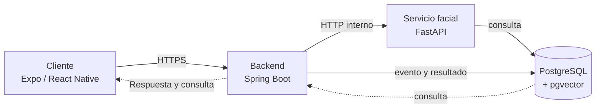

# FaceLit

## Propuesta técnica

**Arquitectura, operación y estado de implementación**

| Corte de información | Estado |
|---|---|
| 27 de octubre de 2026 | Despliegue técnico actualizado; aceptación funcional manual pendiente. |

### Propósito

Presentar cómo FaceLit organiza el contexto académico de asistencia y usa el reconocimiento facial como apoyo de identificación, manteniendo las reglas de negocio y la autorización en el backend.

> Documento actualizado a partir del estado técnico reportado del proyecto. Las cifras de similitud y pruebas se describen con sus límites; no se presentan como precisión biométrica ni como validación institucional.

---

## 01 Problema y solución

La gestión de asistencia requiere relacionar personas, programas, fichas, ambientes y sesiones, y permitir que cada usuario consulte información según sus permisos. FaceLit centraliza esos datos y el flujo de registro en una aplicación.

### Qué resuelve

Coordina preparación de datos, identificación asistida, aplicación de reglas de asistencia y consulta del resultado en un solo flujo.

### Usuarios del sistema

| Rol | Uso principal |
|---|---|
| Coordinación | Administra usuarios, programas, fichas y asociaciones; puede preparar datos mediante CSV. |
| Instructor | Gestiona sesiones y consulta asistencia dentro de su alcance autorizado. |
| Aprendiz | Realiza registro facial y consulta sus resultados habilitados. |

> No se dispone de medición institucional antes/después; no se atribuyen ahorros porcentuales ni reducción cuantificada de errores.

---

## 02 Arquitectura actual

Los cuatro repositorios separan responsabilidades de desarrollo. La aplicación desplegada tiene un backend monolítico modular y un servicio facial independiente; no son cuatro microservicios.

### Recorrido de una captura

1. Cliente solicita el flujo y captura los retos.
2. Envía imágenes al backend por HTTPS.
3. Java valida actor y contexto y llama a FastAPI por red interna.
4. El servicio facial compara referencias en PostgreSQL.
5. Java aplica autorización, reglas de tiempo y duplicados, persiste el evento y devuelve el resultado.

---

## 03 Tecnologías y responsabilidades

| Capa | Tecnología reportada | Responsabilidad |
|---|---|---|
| Cliente | Expo / React Native, TypeScript y JavaScript | Interfaz web/móvil, flujos y captura según plataforma. |
| Backend | Java 17, Spring Boot 3.4.1 | Autenticación, permisos, reglas y coordinación de servicios. |
| Facial | Python 3.11, FastAPI | Procesamiento de secuencia y comparación facial. |
| Datos | PostgreSQL 16, pgvector, Liquibase | Datos relacionales, vectores y cambios versionados de esquema. |
| Despliegue | Docker Compose, Caddy, VPS Hostinger | Aislamiento de servicios, proxy y publicación HTTPS. |

> Los servicios backend, facial y base de datos comparten PostgreSQL. La independencia de datos por servicio no forma parte de la arquitectura vigente.

---

## 04 Flujo facial y reglas

La secuencia activa utiliza cuatro retos de movimiento. Cada registro solicita dos retos distintos y siete imágenes por reto. El cliente envía la captura al backend, que coordina la evaluación facial y aplica las reglas de asistencia.

| Dato | Estado documentado | Cómo interpretarlo |
|---|---|---|
| Retos activos | `MOVE_UP`, `MOVE_DOWN`, `MOVE_CLOSER`, `MOVE_AWAY` | Catálogo reportado para la secuencia vigente. |
| Secuencia | 2 retos distintos × 7 imágenes por reto | Configuración de captura reportada. |
| Umbral | 0.65 similitud | Umbral de comparación; no equivale a 65 % de precisión. |

### Decisión de arquitectura

El cliente no debe contener la clave facial ni conectarse directamente a PostgreSQL. La API de Java conserva la validación de sesión y contexto; FastAPI se invoca dentro de la red privada.

### Pendiente de revisión

> El README del frontend conserva referencias heredadas a variables `EXPO_PUBLIC` para el servicio facial, aunque el flujo de captura descrito usa la API del backend. Verificar el consumo real y el bundle antes de declarar completa esa limpieza.

---

## 05 Despliegue e infraestructura

El corte del 27 de octubre reporta despliegue en un VPS Hostinger con Caddy como servidor web y proxy de API/WebSocket. Solo la capa web expone los puertos 80 y 443; PostgreSQL, backend y servicio facial permanecen en red interna.

| Elemento | Estado reportado |
|---|---|
| Publicación web | HTTPS; ruta web/login responde 200. |
| Servicio facial | Health responde 200. |
| API administrativa | Sin autenticación responde 401, comportamiento esperado para proteger la ruta. |
| WebSocket | Negociación responde 101 en la comprobación reportada. |
| Base de datos | PostgreSQL 16 con pgvector; 45 changesets Liquibase reportados, frente a 39 antes del despliegue. |

> La propuesta anterior con Render/Vercel queda como referencia histórica. Sus costos no describen la infraestructura vigente y deben recalcularse con cotizaciones actuales antes de usarse como presupuesto.

---

## 06 Verificación y resultados

Se reportan verificaciones técnicas de servicios, rutas, migraciones y suites automatizadas. Estas comprobaciones aportan evidencia de integración, pero no sustituyen la aceptación de usuarios ni un estudio de exactitud biométrica.

| Verificación reportada | Alcance y límite |
|---|---|
| Servicio facial: 123 pruebas aprobadas; 1 prueba opcional de PostgreSQL omitida. | Pruebas del servicio; una integración opcional no se ejecutó. |
| Frontend: 120 pruebas en 13 suites; 6 scripts de regresión. | No demuestra por sí solo el flujo completo en dispositivos reales. |
| Integración HTTP con base desechable, inferencia determinista/mock y correo simulado. | No valida cámara física, precisión biométrica ni entrega SMTP real. |
| Chequeos de salud, HTTPS, autorización y WebSocket en producción. | Verificación técnica reportada; aceptación manual aún pendiente. |

> No hay resultados medidos de latencia, carga, rendimiento o precisión con población representativa.

---

## 07 Seguridad, límites y próximos pasos

### Controles y prácticas documentadas

- Mantener secretos y credenciales en configuración privada del VPS.
- Usar HTTPS hacia el cliente y red interna entre servicios.
- Coordinar migraciones antes de iniciar backend con Hibernate `validate`.
- Generar y verificar respaldo antes de cambios de esquema.

### Aceptación pendiente

Probar inicio de sesión real, importación CSV, SMTP real, cámara y asistencia físicas; ejecutar ensayo de restauración; validar APK en dispositivo si se presentará.

### Mejoras futuras

Medir latencia, errores y capacidad con un plan de prueba definido; evaluar el comportamiento biométrico con datos autorizados y criterios aprobados; formalizar retención y eliminación de referencias faciales; revisar la matriz SRS frente a los SHA actuales.

### Referencias de código reportadas al corte

Frontend `5f7d6fe` (dev) • Backend `2ab0bcd` (dev) • Facial `1e12c6c` (dev) • FaceLit-DB `41a063f` (main)

---

**Conclusión:** FaceLit cuenta con una arquitectura desplegada que coordina cliente, backend, servicio facial y PostgreSQL. La siguiente etapa es cerrar la aceptación funcional y medir el desempeño con criterios explícitos.
